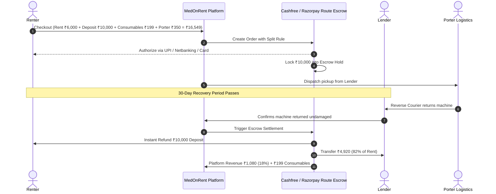

# 📡 MedOnRent — Backend API Contracts & Integration Specifications

This document defines the REST API endpoints, payment gateway escrow split architecture, and logistics webhooks powering the MedOnRent platform.

---

## 1. Escrow & Split-Payment Architecture (Cashfree / Razorpay Route)

MedOnRent acts as a regulated digital intermediary under RBI payment aggregator guidelines.
When a patient family books an item, funds are received into an **Escrow Nodal Account**:



---

## 2. Core API Endpoints

### 2.1 Listings Management

#### `GET /api/listings`
Retrieve verified medical equipment with distance, city, and category filtering.

**Query Parameters:**
- `city` (string, optional): e.g. `Delhi NCR`, `Mumbai`, `Bengaluru`
- `category` (string, optional): `RESPIRATORY`, `HOME_ICU`, `MOBILITY`, `MONITORING`
- `query` (string, optional): keyword search (e.g. `oxygen`, `wheelchair`)
- `maxPrice` (number, optional): maximum monthly rent filter
- `onlySanitized` (boolean, optional): filter for certified hospital-grade sanitization

**Response (200 OK):**
```json
{
  "success": true,
  "count": 6,
  "listings": [
    {
      "id": "list_ox_01",
      "title": "Philips EverFlo 5L Oxygen Concentrator",
      "brand": "Philips Respironics",
      "category": "RESPIRATORY",
      "monthlyRent": 6000,
      "securityDeposit": 10000,
      "conditionVideoUrl": "/videos/ox_sample.mp4",
      "isSanitized": true,
      "sanitizationBadge": "HOSPITAL_GRADE_DISINFECTED",
      "city": "Delhi NCR",
      "pincode": "122002",
      "owner": {
        "fullName": "Col. Rajesh V. (Retd.)",
        "isKycVerified": true,
        "rating": 4.95,
        "reviewsCount": 14
      }
    }
  ]
}
```

#### `POST /api/listings`
Publish idle medical equipment to the marketplace.

**Request Body:**
```json
{
  "ownerId": "usr_9812",
  "title": "Invacare Platinum 9L High-Flow Oxygen Unit",
  "brand": "Invacare",
  "category": "RESPIRATORY",
  "originalRetailPrice": 75000,
  "monthlyRent": 7000,
  "securityDeposit": 12000,
  "conditionVideoUrl": "https://r2.medonrent.in/videos/proof_invacare_77.mp4",
  "pickupAddress": "Flat 402, DLF Phase 2, Gurugram",
  "city": "Delhi NCR",
  "pincode": "122002",
  "bankAccount": {
    "accountNumber": "987654321098",
    "ifsc": "HDFC0001234",
    "beneficiary": "Rajesh Verma"
  }
}
```

---

### 2.2 Bookings & Escrow Initiation

#### `POST /api/bookings`
Creates an escrow hold and locks the rental.

**Request Body:**
```json
{
  "listingId": "list_ox_01",
  "renterId": "usr_renter_42",
  "durationDays": 30,
  "includeConsumablesKit": true,
  "deliveryAddress": "B-14, Green Park Extension, New Delhi",
  "pincode": "110016"
}
```

**Response (201 Created):**
```json
{
  "success": true,
  "booking": {
    "bookingNumber": "MOR-2026-9182",
    "status": "ESCROW_LOCKED",
    "financials": {
      "baseRent": 6000,
      "securityDeposit": 10000,
      "consumablesKit": 199,
      "porterDelivery": 350,
      "totalCharged": 16549,
      "platformCommission18Pct": 1080,
      "lenderPayout82Pct": 4920,
      "refundableDeposit": 10000
    },
    "escrowStatus": "HELD_IN_ESCROW",
    "pickupOtp": "8392",
    "returnOtp": "4910"
  }
}
```

---

### 2.3 Automated Escrow Release / Return Settlement

#### `POST /api/escrow/release`
Called automatically or by owner approval when equipment is safely returned.

**Request Body:**
```json
{
  "bookingNumber": "MOR-2026-9182",
  "confirmedCondition": "UNDAMAGED_WORKING",
  "inspectorSignature": "Lender Col. Rajesh V.",
  "deductionAmount": 0
}
```

**Response (200 OK):**
```json
{
  "success": true,
  "settlement": {
    "renterDepositRefunded": 10000,
    "renterRefundMethod": "UPI (rajesh@oksbi)",
    "lenderPayoutDisbursed": 4920,
    "lenderBankRef": "NEFT-HDFC-912083",
    "platformNetRevenue": 1279,
    "status": "COMPLETED_SETTLED"
  }
}
```

---

## 3. Webhook Specs (Porter Logistics & Cashfree Gateway)

### 3.1 Porter Delivery Status Webhook (`POST /api/webhooks/porter`)
```json
{
  "event": "ORDER_DELIVERED",
  "porter_order_id": "CR_DEL_8921",
  "medonrent_booking_id": "MOR-2026-9182",
  "driver_name": "Mukesh Kumar",
  "delivered_at": "2026-09-12T14:30:00Z",
  "recipient_otp_verified": true
}
```

### 3.2 Cashfree Split Settlement Webhook (`POST /api/webhooks/cashfree`)
```json
{
  "type": "SPLIT_TRANSFER_SUCCESS",
  "data": {
    "order_id": "MOR-2026-9182",
    "split": [
      { "merchant_vendor_id": "vnd_lender_col_rajesh", "amount": 4920, "status": "SUCCESS" },
      { "merchant_vendor_id": "vnd_medonrent_corp", "amount": 1279, "status": "SUCCESS" }
    ]
  }
}
```
