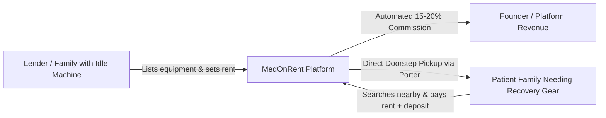
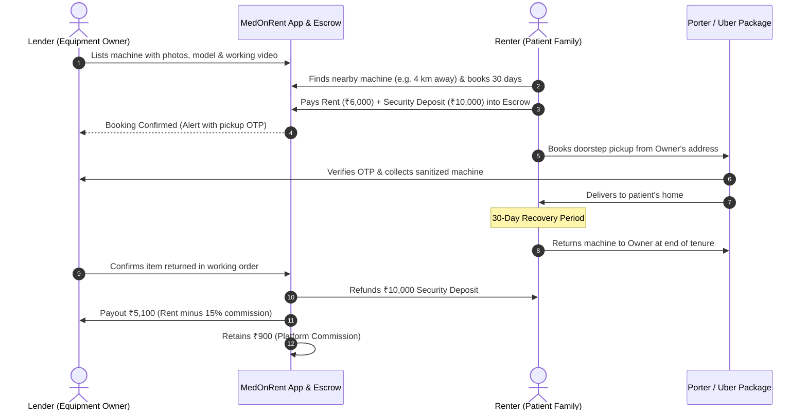
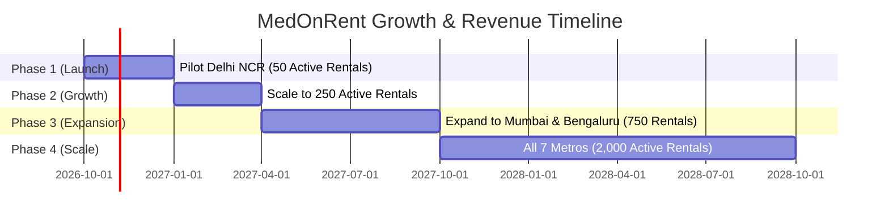
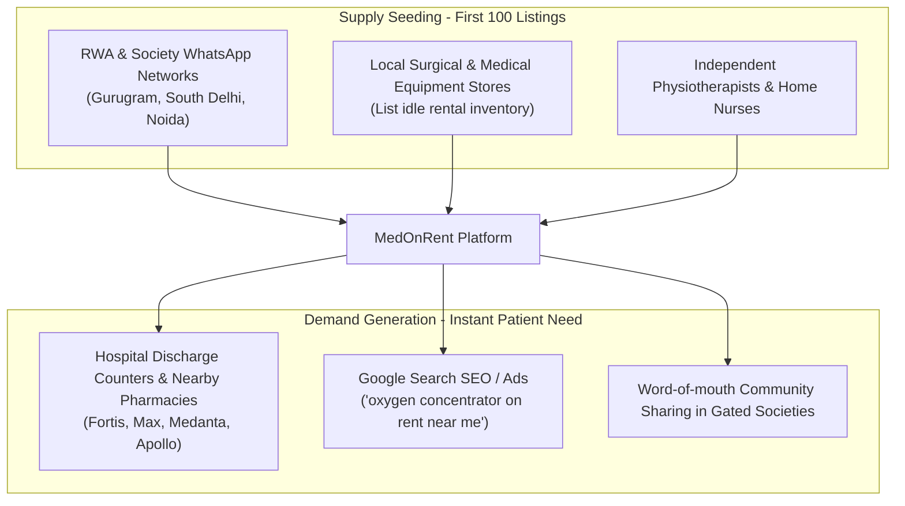

# 🏥 MedOnRent — Comprehensive Startup Blueprint & Business Plan
> **Tagline:** *Care in Circulation — Why Buy When You Can Rent?*  
> **Business Model:** Peer-to-Peer (P2P) Medical Equipment Rental Marketplace  
> **Market Focus:** Pan-India Metros (Delhi NCR, Mumbai, Bengaluru, Hyderabad, Chennai, Pune, Kolkata)  
> **Date:** September 2026

---

## 1. Executive Summary

**MedOnRent** is an asset-light, two-sided peer-to-peer (P2P) digital marketplace that connects families possessing idle, post-recovery medical equipment with patients who urgently need temporary home healthcare gear.

### Key Highlights
- **Zero Inventory / Zero Warehouses:** The platform does not purchase, store, or own a single wheelchair or oxygen machine.
- **Zero Delivery Fleet:** Handover logistics are fulfilled on-demand via integrated 3rd-party couriers (Porter / Uber Package) paid by the renter.
- **Automated Escrow & Commissions:** Rent and refundable deposits are managed digitally; the platform deducts a **15% to 20% commission automatically** upon return.
- **High Ticket Size:** Medical rentals range from ₹2,000 to ₹12,000 per month, generating high commission revenue per transaction.

---

## 2. The Problem & Market Opportunity

### The Dilemma of the Indian Family
When an elderly parent or family member suffers a fracture, stroke, cardiac event, or post-operative recovery, the household enters a crisis:

| Equipment | Cost to Buy New | Typical Duration Needed | Post-Recovery Reality |
|---|---|---|---|
| **Oxygen Concentrator (5L/10L)** | ₹45,000 – ₹75,000 | 2 to 6 weeks | Gathers dust in balcony / storeroom |
| **Motorized Hospital Bed** | ₹32,000 – ₹60,000 | 1 to 3 months | Bulky, cannot be easily disposed of |
| **BiPAP / CPAP Machine** | ₹40,000 – ₹85,000 | 1 to 2 months | Idle capital trapped |
| **Wheelchair (Manual / Electric)** | ₹7,000 – ₹35,000 | 3 to 8 weeks | Kept "just in case", unused |
| **Air Mattress & Suction Pump** | ₹4,000 – ₹12,000 | 2 to 4 weeks | Stored away indefinitely |

### The Two-Sided Market Inefficiency
1. **The Lender's Pain:** Selling on OLX is filled with low-ballers offering 5% of value, or online scammers. The owner gets zero value from a ₹60,000 machine sitting idle.
2. **The Renter's Pain:** Commercial surgical rental shops are fragmented, unverified, charge exorbitant deposits, and lack transparent ratings or digital tracking.

---

## 3. The MedOnRent Solution

MedOnRent transforms idle medical hardware into liquid, income-generating community assets.

---

## 4. Product Categories & Rental Pricing Matrix

| Category | High-Demand Equipment | Average Buy Price | Recommended Monthly Rent | Typical Security Deposit | Your 18% Cut per Month |
|---|---|---|---|---|---|
| **Respiratory** | Oxygen Concentrator 5L/10L | ₹55,000 | ₹5,500 – ₹7,500 | ₹10,000 | **₹990 – ₹1,350** |
| **Respiratory** | BiPAP / CPAP Unit | ₹50,000 | ₹5,000 – ₹7,000 | ₹10,000 | **₹900 – ₹1,260** |
| **Home ICU** | 3-Function Motorized Bed | ₹40,000 | ₹4,500 – ₹6,000 | ₹8,000 | **₹810 – ₹1,080** |
| **Home ICU** | Anti-Bedsore Air Mattress | ₹4,500 | ₹800 – ₹1,200 | ₹1,500 | **₹144 – ₹216** |
| **Mobility** | Foldable Wheelchair (Standard) | ₹7,500 | ₹1,200 – ₹1,800 | ₹2,500 | **₹216 – ₹324** |
| **Mobility** | Motorized Electric Wheelchair | ₹35,000 | ₹4,000 – ₹6,000 | ₹8,000 | **₹720 – ₹1,080** |
| **Mobility** | Walker / Crutches Set | ₹2,500 | ₹400 – ₹600 | ₹800 | **₹72 – ₹108** |

---

## 5. Revenue Projections (Unit Economics)

### Revenue Streams
1. **Primary Rental Commission:** 15% to 20% on all rental transactions.
2. **Platform Convenience Fee:** ₹99 to ₹199 per checkout.
3. **Verified Sanitization Badge:** ₹149 one-time inspection/checklist badge for premium listings.
4. **Recurring Extensions:** ~40% of patient families extend rental duration by 1–2 months, yielding repeat automatic commissions without acquisition cost.

### Financial Growth Trajectory (Delhi NCR & Metros)

| Milestone | Active Monthly Rentals | Monthly Gross Merchandise Value (GMV) | Monthly Platform Revenue (18% Cut + Fees) | Annualized Run-Rate |
|---|---|---|---|---|
| **Month 3 (Pilot)** | 50 units | ₹2,50,000 | **₹45,000 – ₹50,000** | ₹6,00,000 |
| **Month 6 (Scale)** | 250 units | ₹12,50,000 | **₹2,25,000 – ₹2,50,000** | ₹30,00,000 |
| **Month 12 (3 Metros)** | 750 units | ₹37,50,000 | **₹6,75,000 – ₹7,50,000** | ₹90,00,000 |
| **Year 2 (All Metros)** | 2,500 units | ₹1,25,00,000 | **₹22,50,000 – ₹25,00,000** | ₹3,00,00,000 (₹3 Cr) |

---

## 6. Risk Management & Trust Architecture

> [!IMPORTANT]
> A P2P equipment marketplace succeeds or fails on **Trust, Asset Protection, and Hygiene**.

### 1. Theft & Damage Prevention
- **DigiLocker / Aadhaar OTP Verification:** Both Renter and Owner must complete instant government ID KYC before any transaction is authorized.
- **Escrow Security Deposit:** The renter deposits 20%–35% of the machine's depreciated replacement value, held securely via payment gateway escrow (Razorpay Route / Cashfree).
- **Mandatory Pre-Handover Video:** The lender records a 5-second in-app video showing the machine powering on, screen working, and physical condition before releasing to the courier.

### 2. Hygiene & Infection Control Protocol
- Medical equipment surfaces (metal frames, plastic housings) are non-porous and disinfected using standard hospital-grade isopropyl / benzalkonium sprays.
- **Disposable Barrier Rule:** All patient-contact consumables (oxygen nasal cannulas, masks, tubing, bedsheets) must be purchased brand new by the renter (available as a 1-click ₹199 add-on in the app).

### 3. Legal & Medical Disclaimer
- MedOnRent operates strictly as an intermediary under the Information Technology Act.
- Explicit agreement that equipment must be operated solely under the advice of a qualified physician, with zero platform clinical liability.

---

## 7. Brand Identity & Visual Assets

- **Brand Name:** **MedOnRent**
- **Domain Targets:** `medonrent.in` / `medonrent.com`
- **Visual Motif:** Continuous mobius-loop ribbon forming a medical cross (symbolizing circular economy and healing).
- **Color Codes:**
  - `Deep Medical Navy` (`#0B192C`): Stability & Security
  - `Oceanic Teal` (`#007791`): Clinical Trust & Innovation
  - `Recovery Emerald` (`#10B981`): Health, Life & Availability
- **Assets Location:** All 4K master files and transparent PNGs are stored in `F:\EGO\medonrent-assets\`.

---

## 8. Go-To-Market (GTM) Playbook

1. **Step 1 — Supply Seeding (Weeks 1–4):**
   - Run hyper-local outreach in gated societies in Delhi NCR (DLF Phase 1-5, Nirvana Country, ATS Village, Greater Kailash) offering owners free listing + ₹500 welcome bonus on their first rental.
2. **Step 2 — Hospital Discharge Partnerships (Weeks 3–6):**
   - Place informational standees / QR cards at private medical stores directly opposite major hospitals (Medanta, Max Healthcare, Apollo, Fortis).
3. **Step 3 — Google Search Engine Dominance (SEO):**
   - Deploy city and locality programmatic landing pages:  
     `medonrent.in/rent-oxygen-concentrator-delhi`  
     `medonrent.in/rent-wheelchair-gurgaon`  
     `medonrent.in/rent-hospital-bed-noida`

---

## 9. Technology Architecture

- **Mobile Client:** React Native / Expo (Single codebase for Android & iOS).
- **Web App:** Next.js / React with SEO server-side rendering for Google Search dominance.
- **Backend Services:** Node.js / Express or Fastify with PostgreSQL database.
- **Payment & Split Escrow:** Cashfree Marketplace / Razorpay Route API (splits transaction: 82% to Lender, 18% to MedOnRent platform account).
- **Identity & KYC:** Sandbox / Zoop.one Aadhaar XML OTP verification.
- **Logistics Integration:** Porter On-Demand API webhook for seamless 1-click delivery scheduling.
